<div align="center">
  <picture>
    <source media="(prefers-color-scheme: dark)" srcset="home_finance_cockpit/ui/assets/branding/wordmark-ui-dark.svg">
    <source media="(prefers-color-scheme: light)" srcset="home_finance_cockpit/ui/assets/branding/wordmark-ui-light.svg">
    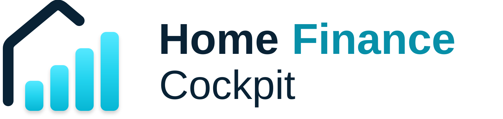
  </picture>

  <h1>Home Finance Cockpit</h1>
  <p><strong>Your finances in one place. A consistent way to understand them.</strong></p>
  <p>Analyse money held across banks, savings accounts and other assets in one Windows app.<br>The same categories, filters and reports, wherever your money is held.</p>

  <p>
    
    
    <a href="LICENSE"></a>
  </p>

  <p><a href="#installation">Install on Windows 11</a> &middot; <a href="#explore-the-app">Explore the app</a> &middot; <a href="#for-developers">For developers</a></p>
</div>

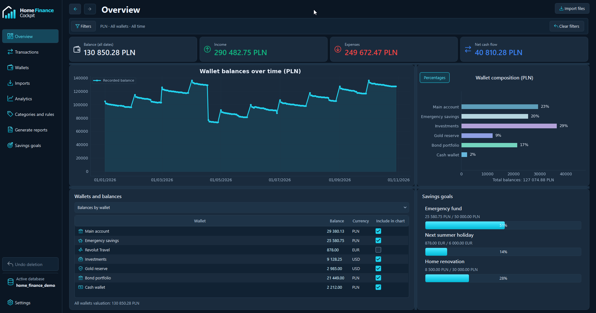

Banking apps give you a view of the money held with that bank, but their analysis tools can be limited. With accounts at several banks, you also have different interfaces, categories and ways of calculating totals. Understanding your finances as a whole means piecing those separate views together.

Home Finance Cockpit brings those accounts into one place and applies the same analysis across them. Compare spending, follow balances and work towards savings goals using a consistent set of categories, filters and reports. You can look at one wallet or combine several without switching between banking apps.

Your finances can also include things that never appear in a bank statement. Record cash or the value of holdings such as gold in a separate wallet and update them manually. Bank imports help you bring transactions in; the aim is a clearer picture of everything you choose to track.

**No cloud account or bank login is required.** The interface is available in English and Polish, with light and dark themes.

## What you can do

| Feature | What it covers |
| --- | --- |
| **See your finances together** | Bring accounts from different banks, savings, cash and manually recorded holdings into one view. |
| **Use the same analysis everywhere** | Apply consistent categories, filters and reports to individual wallets or several at once. |
| **Spend less time categorising** | Apply reusable rules to new imports and existing transactions. |
| **Find the transaction you need** | Combine column filters, signed amount ranges, search and multi-column sorting. |
| **See what changed** | Explore categories, monthly trends, counterparties and comparisons between periods. |
| **Keep goals in sight** | Track savings targets alongside your wallet balances. |
| **Take your results with you** | Generate monthly and annual PDF reports with the sections you choose. |

## Installation

**Supported platform: Windows 11, 64-bit.** The installer includes Python and the application dependencies.

1. Open the repository's [Releases page](../../releases).
2. Download `HomeFinanceCockpit-1.0.0-windows-x64.msi` from the release assets. The GitHub **Source code** ZIP is for developers.
3. Run the MSI and follow the installation steps.
4. Launch **Home Finance Cockpit** from the Windows Start menu.
5. Choose **English** or **Polski**, then create a database in a folder you control or open an existing one.
6. Create a wallet and import a statement, or try the demo below.

The default installation is per user and does not require a separate Python installation. Settings and logs are stored in `%LOCALAPPDATA%\HomeFinanceCockpit`. Your database stays in the location you choose. Uninstalling the application leaves your financial data in place.

**Installer signing:** the Windows installer is currently unsigned. Windows 11 devices using Smart App Control or publisher restrictions may block it. See [Microsoft's explanation of Smart App Control](https://support.microsoft.com/en-us/windows/security/threat-malware-protection/smart-app-control-frequently-asked-questions).

### Bank export compatibility

**Import has so far been adapted and tested only with ING and Revolut exports.**

The importer accepts CSV, XLSX and XLSM files and lets you map their columns. Other banks may work with a suitable mapping, but their formats have not been verified. Always check the preview, amounts and dates before confirming an import. This is a file-based workflow; the app does not connect to your bank account.

### Try it with demo data

The screenshots use fictional data: **667 transactions, 7 wallets, 3 currencies and 10 months of activity**. The dataset includes salary payments, everyday purchases, holidays, internal transfers and regular savings contributions.

Copy [home_finance_demo.db](example/database/home_finance_demo.db) to a writable folder, then open that copy in the app. Choose **All time** or a period between January and October 2026 to explore the full dataset.

See the [demo guide](example/README.md) for the CSV/XLSX files, category configuration and instructions for rebuilding the database. No personal bank data is included in the demo.

## Explore the app

### Work through your transactions

Filter directly under each column, including dates, wallets, categories, amounts and the balance after a transaction. Collapse the filter row when you need more space; the filters stay active.

Resize columns to suit your view, use Ctrl-click to sort by multiple columns, and move or copy selected transactions between wallets. Uncategorized transactions and possible conflicts have their own quick views.

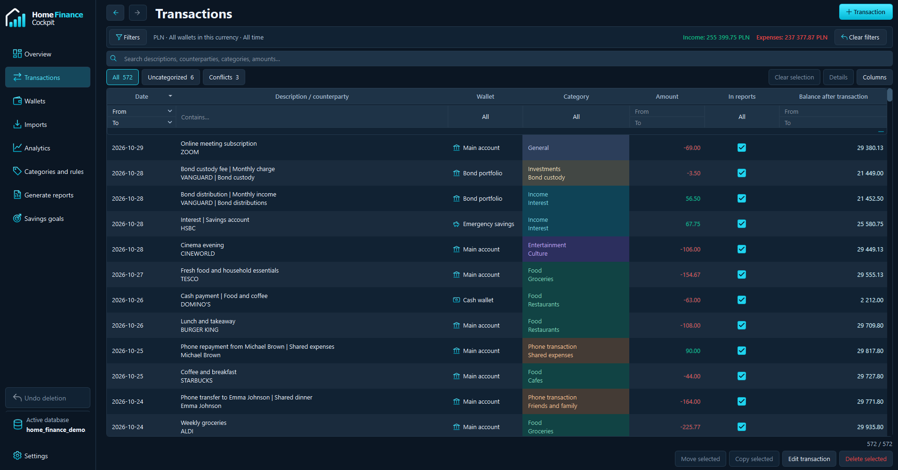

### Review imports before anything is saved

Import one file or a batch, choose the destination wallet, and review the source data alongside the mapped result. The workflow separates source selection, mapping and final confirmation. Duplicate checks and row-level validation help catch issues before committing the import.

Only mapped fields are retained in the database. Unused source columns remain part of the preview.

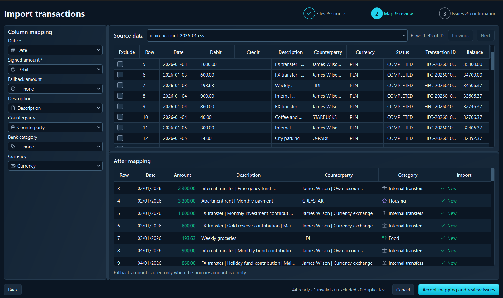

<details>
<summary><strong>View the import history</strong></summary>

Track imported files, inspect their transactions and change the destination wallet for an entire import.

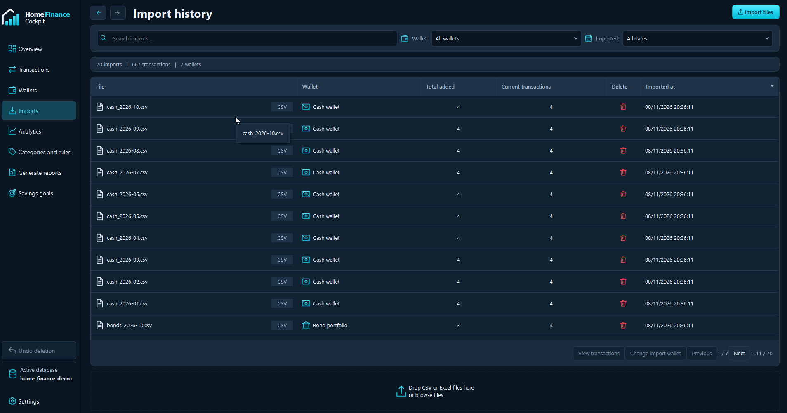

</details>

### Understand your spending

Start with a category breakdown, then expand the table to see subcategories, transaction counts and totals. The same wallet, currency and period filters apply across the analytics views.

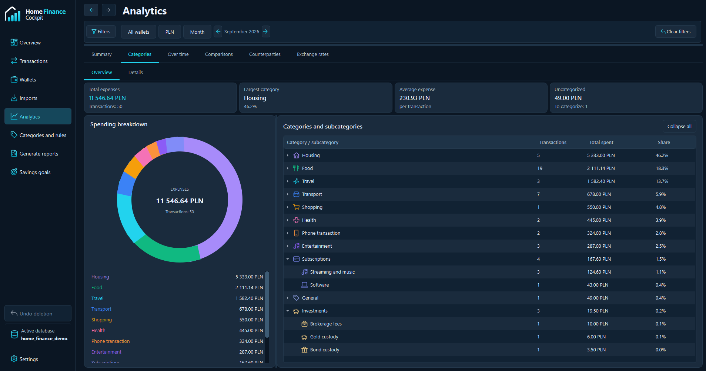

<details>
<summary><strong>View more analytics screens</strong></summary>

#### Monthly summary

Compare income, expenses and category spending across months.

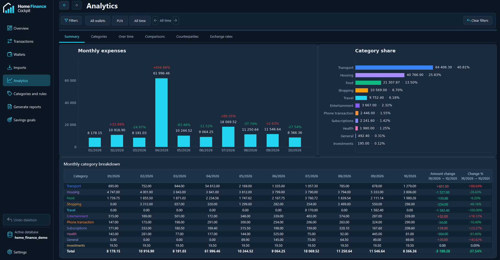

#### Category details

Follow individual categories and subcategories over time.

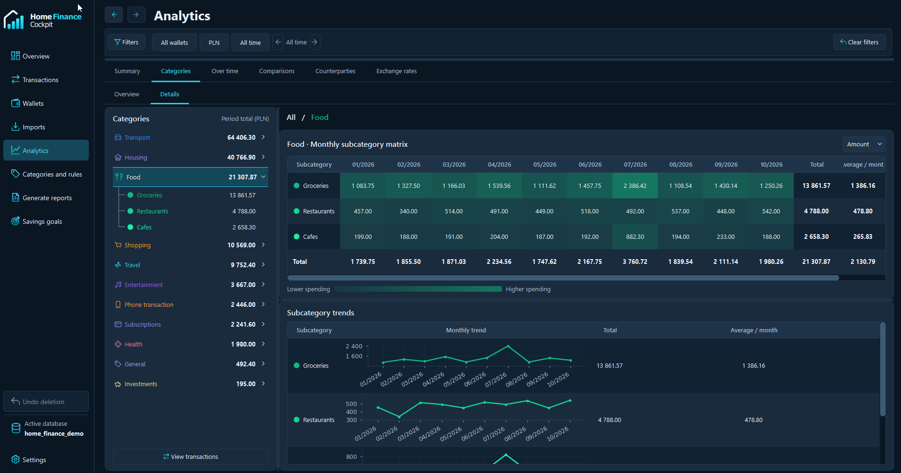

#### Period comparisons

Compare two periods and find the categories behind the change. Open the underlying transactions to investigate further.

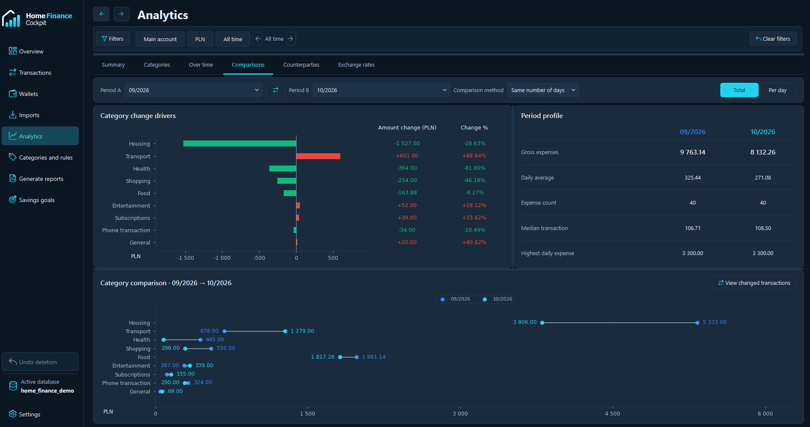

#### Counterparties

See where you spend most, with monthly totals and transaction details for each counterparty.

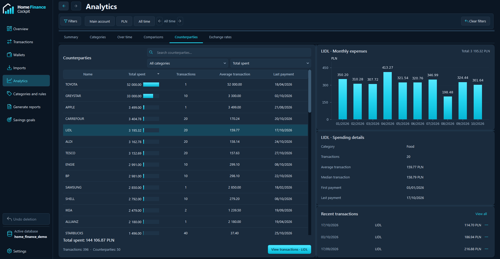

</details>

### Make categorisation repeatable

Build categories and subcategories with their own visual identity. Add rules based on transaction fields, combine conditions, and apply them to your history. Rule counters show how many transactions use each rule. Category and rule configurations can be exported and imported as JSON.

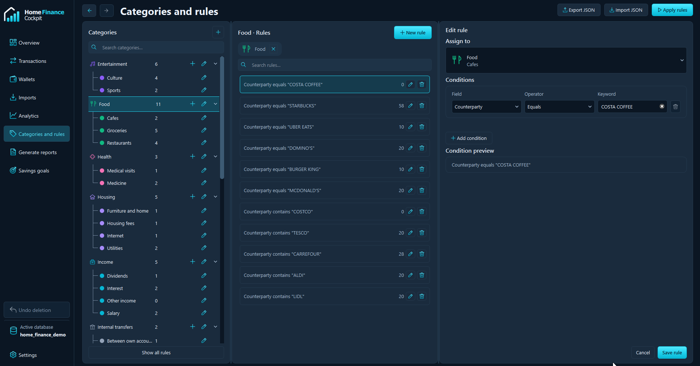

<details>
<summary><strong>View wallets and savings goals</strong></summary>

#### Wallets

Keep separate balances and histories for bank accounts, cash and savings in different currencies. You can also use a wallet to record the value of assets such as gold, with manual updates when that value changes. Mark internal transfers so they can be handled separately in analysis and reports.

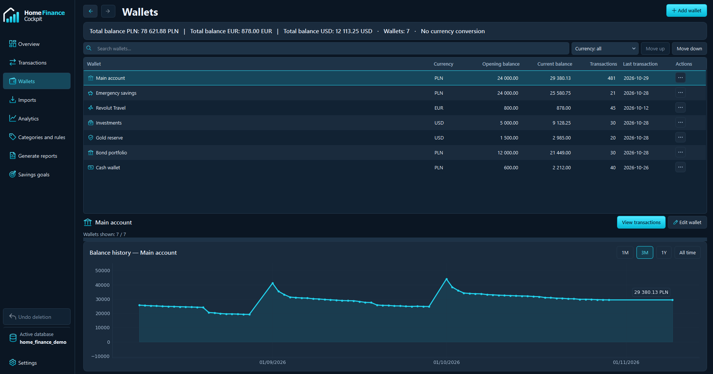

#### Savings goals

Set a target and deadline, follow wallet-linked progress or track contributions manually.

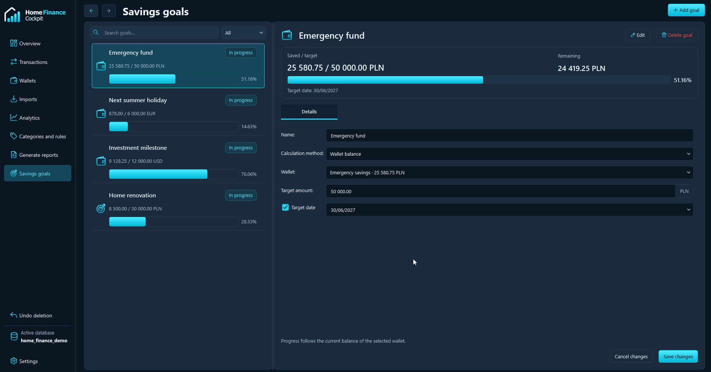

</details>

<details>
<summary><strong>View PDF report generation</strong></summary>

Choose wallets, currency and months, optionally include an annual report, and select which sections to export. The app shows the planned reports before generation.

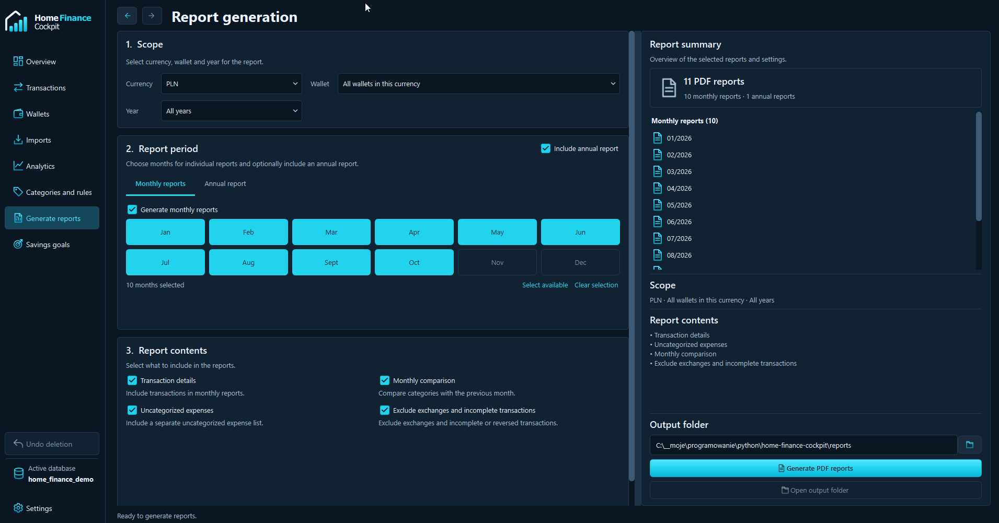

</details>

### Keep control of your data

- Local SQLite databases with optional password protection through SQLCipher.
- Manual backups and configurable automatic backups.
- Core financial features work offline. Exchange-rate updates use the NBP API when enabled.
- English and Polish interfaces, light and dark themes, and configurable keyboard shortcuts.

Keep a backup of your database before making large changes. If you enable encryption, keep the password safe; it is not stored in application preferences.

## For developers

Built by [Łukasz Kozłowski](https://github.com/L-Kozlowski).

I built Home Finance Cockpit to give people one consistent way to analyse their finances, even when their money is spread across several banks and other assets. A bank's app only shows part of that picture, and using several apps means working with different tools and definitions. I wanted the analysis to stay the same regardless of where the money is held, with room for things such as cash or gold that users record themselves.

That goal shaped the technical work: importing and validating data from different sources, keeping financial calculations consistent, building interactive analysis views, and packaging the result as a desktop application.

| Area | Implementation |
| --- | --- |
| Desktop interface | Python 3.12, PyQt6, custom table filters and Matplotlib charts |
| Persistence | SQLite, versioned schema migrations, SQLCipher encryption and backup handling |
| Financial values | Integer minor units for stored money and `Decimal` for parsing and calculations |
| Imports | CSV and Excel parsing, configurable mapping, duplicate detection and transactional writes |
| Reporting | ReportLab PDF output with charts, tables and application branding |
| Quality and delivery | `unittest` regression tests, Ruff, pinned dependencies and cx-Freeze MSI packaging |

The 1.0.0 preparation passed **442 regression tests** and an integration self-test covering imports, database operations, encryption, PDF output and both interface languages. The MSI passed metadata, extraction and file-integrity checks. Launch testing of the packaged EXE was blocked by the build environment's code-signing policy; a clean Windows installation and launch test is still pending.

### Run from source

Use **Python 3.12.10 x64 on Windows**. From the repository root:

```powershell
py -3.12 -m venv .venv
.\.venv\Scripts\python.exe -m pip install -r requirements.txt
.\.venv\Scripts\python.exe main.py
```

To open a copy of the demo:

```powershell
Copy-Item example\database\home_finance_demo.db .\my-demo.db
.\.venv\Scripts\python.exe main.py --database .\my-demo.db
```

### Run the checks

```powershell
.\.venv\Scripts\python.exe -m pip install -r requirements-dev.txt
.\.venv\Scripts\python.exe -m pip check
.\.venv\Scripts\python.exe tools/run_checks.py
.\.venv\Scripts\python.exe -m ruff check home_finance_cockpit tests tools main.py
```

Runtime dependencies are constrained by [requirements-runtime-lock.txt](requirements-runtime-lock.txt). Build tools are separate in [requirements-build.txt](requirements-build.txt).

The code is organised into `domain`, `storage`, `services`, `reports` and `ui` modules inside `home_finance_cockpit/`. Release preparation and installer verification scripts are in `tools/`; build dependencies are listed separately in `requirements-build.txt`.

## Feedback

If something does not import correctly, [open an issue](../../issues) with the app version, file format, expected result and the steps to reproduce it. An anonymised sample row is useful. Remove account numbers, names, addresses and other personal details before sharing files or screenshots.

Reports from other bank export formats are welcome, particularly when accompanied by a small, anonymised example.

## License

Home Finance Cockpit is licensed under [GNU GPL v3 only](LICENSE). Copyright 2026 Łukasz Kozłowski.

Third-party libraries and assets retain their own licenses. See [COPYRIGHT.md](COPYRIGHT.md), [THIRD_PARTY_NOTICES.md](THIRD_PARTY_NOTICES.md) and [licenses/](licenses/). Windows releases include companion application and dependency source archives.
