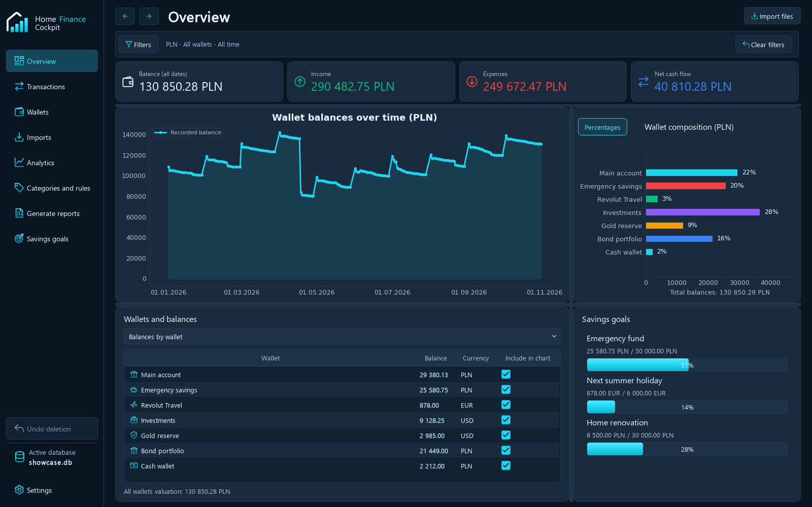
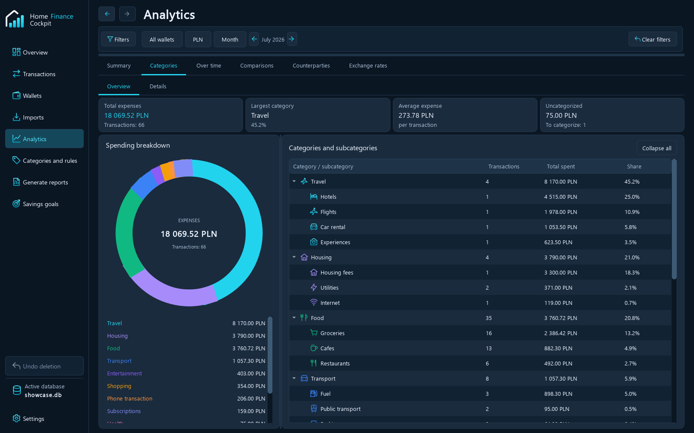

# Home Finance Cockpit — English showcase

**667 transactions · 10 months · 7 wallets · 3 currencies · 70 CSV imports**

A fictional financial year for **James Wilson**, designed for screenshots, product
walkthroughs and repeatable testing. All balances, prices, earnings, interest and
exchange rates are synthetic. Company names are illustrative counterparties.



## Open the ready-made database

1. Copy [home_finance_demo.db](database/home_finance_demo.db) into your own `data/` folder.
2. Open the copy in Home Finance Cockpit and select **English** in settings.
3. Use **All time**, or choose a month from **January–October 2026**.

November and December intentionally contain no transactions. The original database
is a clean reference; use a copy when trying imports, edits or deletion.

```powershell
.\.venv\Scripts\python.exe tools/create_demo_database.py --output data/showcase.db
.\.venv\Scripts\python.exe main.py --database data/showcase.db
```

The generator never overwrites a user-selected database. It uses the application's
real CSV importer and classification services, then applies the explicit review
metadata in [demo_setup.json](config/demo_setup.json).

## The financial story

| Period | Activity to explore |
|---|---|
| January–March | Monthly salary, household bills, groceries, subscriptions and regular saving. A March bonus strengthens the upward trend. |
| April | A **52,000 PLN Toyota purchase**, annual Allianz insurance and a **22,000 PLN release from savings** create a clear drop in total tracked wealth. |
| May–June | New tyres, maintenance and a summer travel top-up. An Amazon return received in June offsets a purchase made in May when using refund-aware analysis. |
| July | A pay rise and a holiday paid from Revolut: Lufthansa flights, Marriott hotel, Hertz rental and GetYourGuide activities. |
| August–October | A laptop replacement, a September bonus and city break, home improvements and renewed asset accumulation. |

Total tracked wealth starts at **90,040.00 PLN**, reaches **123,458.47 PLN** in March,
falls to **80,193.96 PLN** in April and ends at **130,850.28 PLN** in October.
Transfers between the person's own accounts do not create wealth or report expenses.

## Wallets

| Wallet | Currency | Opening balance | Demonstrates |
|---|---|---:|---|
| Main account | PLN | 24,000.00 | Salary, card purchases, rent, bills and phone payments |
| Emergency savings | PLN | 24,000.00 | Monthly contributions, interest and the car-purchase withdrawal |
| Revolut Travel | EUR | 800.00 | Currency conversion, holiday spending and a city break |
| Investments | USD | 5,000.00 | Monthly contributions, dividend receipts and brokerage fees |
| Gold reserve | USD | 1,500.00 | Regular contributions and custody charges |
| Bond portfolio | PLN | 12,000.00 | Monthly contributions, distributions and custody charges |
| Cash wallet | PLN | 600.00 | Paired cash withdrawals and everyday cash purchases |

The investment, gold and bond wallets contain **monetary ledger values**. They do not
claim to track security quantities, physical gold weights, live prices or investment
performance. Their growth primarily represents contributions. Manual valuation
rates are **1 EUR = 4.30 PLN** and **1 USD = 4.00 PLN**.

The separately stored, varying FX history is fictional and marked **manual**. It is
there to demonstrate the currency-history screen. Automatic downloads are disabled
in the demo, so presentation and totals are repeatable offline.

## Categories, rules and transaction meaning

The dataset shares its configuration with the starter profile for new databases:

**Food · Housing · Transport · Health · Shopping · Entertainment · Income ·
Subscriptions · Travel · Investments · Phone transaction · Internal transfers**

Each category and subcategory has an application icon; root categories also have
consistent chart colors. Matching uses saved application fields, including compound
conditions. **UBER** and **UBER EATS**, for example, go to different branches.

Descriptions, merchant names, common fictional names and category names are English.
Phone transfers use recipients such as **John Smith** and **Emma Johnson**; shared
expenses include a repayment from **Michael Brown**.

Salary, purchase refunds, personal reimbursements and both sides of internal/FX
transfers have explicit transaction kinds. Four business-related operations are
unchecked for reports to demonstrate inclusion controls. Ordinary demo transactions
are classified by the real rules, not by hard-coded category IDs.

Six purchases intentionally remain uncategorized, including a recent Zoom subscription,
to demonstrate the **Uncategorized** view. Three older Amazon operations show possible
counterparty inconsistencies after a reviewed furniture purchase. None of the latest
20 transactions has a conflict hint, including when viewing an individual wallet or
currency. Own-account and Vanguard account identifiers distinguish transfer and
product types without hiding the application's conflict detection.

New user databases receive the localized categories, subcategories and editable
rules. They still start with **no invented transactions or money**, one empty main
wallet and the existing example emergency-fund goal. Existing databases are unchanged.



## Four savings goals

- **Emergency fund** — wallet-based, PLN.
- **Next summer holiday** — wallet-based, EUR.
- **Investment milestone** — wallet-based, USD.
- **Home renovation** — manually allocated, PLN.

## Import files and reproducibility

| File | Purpose |
|---|---|
| [demo_setup.xlsx](demo_setup.xlsx) | Wallet and import index |
| [config/demo_setup.json](config/demo_setup.json) | Complete manifest, paired transfers, review metadata, rates and goals |
| [config/categories_demo.json](config/categories_demo.json) | Portable category tree, icons, colors and rules |
| [expected_totals.json](expected_totals.json) | Exact report totals, wallet balances and monthly wealth checks |
| `transactions/<wallet>/<wallet>_2026-MM.csv` | Ten monthly statements per wallet |
| Matching `.xlsx` files | Human-readable copies; import the CSV files into the app |
| `transactions/scenarios/cash_overlap_2026-10.csv` | Two known rows and two new rows for duplicate detection |
| `transactions/scenarios/import_validation.csv` | Isolated preview of valid, duplicate and invalid rows |

Main-account CSVs use English **Debit / Credit** columns and `;`. Other wallets use
a signed **Amount** column and `,`. The manifest gives the exact mapping for each
file. A source **Balance** column is supplied for cross-checking and intentionally
is not mapped or retained. Quoted descriptions are included, such as the IKEA
`"BILLY"` purchase.

For manual setup, import the category file first, create the seven wallets with the
opening balances above, then import the statements in chronological order per wallet.
CSV category rules assign categories; explicit kinds and report inclusion are review
steps, recorded by external transaction ID in the manifest. The demo generator
performs those review steps automatically. Reimporting the 70 original statements
adds **zero** duplicate transactions.

To rebuild the published synthetic assets and reference database:

```powershell
.\.venv\Scripts\python.exe tools/build_examples.py --database
.\.venv\Scripts\python.exe tools/capture_showcase.py
.\.venv\Scripts\python.exe -m unittest tests.test_examples tests.test_starter_data
```

Rebuilding the published showcase deliberately replaces its generated reference
database. It never targets your `data/` databases. Previous generated examples were
archived under `other/example-before-english-2026/`; supplied legacy source exports
in `source/` and `config/categories_original.json` remain untouched and are not part
of the new showcase import manifest.

See [SCREENSHOTS.md](SCREENSHOTS.md) for the complete English screenshot tour.
